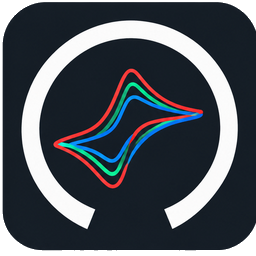

<p align="center">
  
</p>

<h1 align="center">DStat-RD</h1>

<p align="center">
  <strong>Potenciostato / Galvanostato de código abierto</strong> basado en la plataforma DStat, adaptado y modernizado para investigación, docencia y aplicaciones de laboratorio.
</p>

---

## 📋 Tabla de Contenidos

- [Presentación](#presentación)
- [Identidad Visual y Logotipo](#identidad-visual-y-logotipo)
- [Características Principales](#características-principales)
- [Galería](#galería)
- [Estructura del Repositorio](#estructura-del-repositorio)
- [Instalación y Puesta en Marcha](#instalación-y-puesta-en-marcha)
- [Documentación](#documentación)
- [Atribución y Créditos](#atribución-y-créditos)
- [Uso de Inteligencia Artificial (LLMs)](#-declaración-sobre-el-uso-de-inteligencia-artificial-llms)
- [Licencia](#licencia)

---

## 🔬 Presentación

**DStat-RD** es una evolución y actualización de la plataforma de instrumentación electroquímica de bajo costo y hardware abierto **DStat**. Este repositorio centraliza la interfaz gráfica de usuario (GUI), el diseño mecánico de la carcasa y accesorios, la documentación de montaje y calibración, y las guías de uso del instrumento.

---

## 🎨 Identidad Visual y Logotipo

<p align="center">
  
</p>

El logotipo de **DStat-RD** nace de la convergencia visual entre dos pilares esenciales del proyecto:

1. **El *"Keyhole Logo"* de la Open Source Initiative (OSI):**  
   Diseñado originalmente por **Colin Viebrock** en 1998, este símbolo representa una cerradura abierta y *"simboliza el desbloqueo del código fuente"* (*"symbolizes unlocking source code"*), sintetizando el espíritu de transparencia, libertad de estudio y colaboración abierta.
2. **Las curvas de Voltamperometría Cíclica (CV) del paper original de DStat:**  
   Inspiradas directamente en los perfiles voltamperométricos del artículo fundacional:
   > *Dryden, M. D. M., & Wheeler, A. R. (2015). DStat: A Versatile, Open-Source Potentiostat for Electroanalysis and Integration. PLoS ONE 10(10): e0140349. [doi:10.1371/journal.pone.0140349](https://doi.org/10.1371/journal.pone.0140349)*  
   En dicha publicación, los autores validan y contrastan experimentalmente las curvas de voltamperometría cíclica del DStat frente a potenciostatos comerciales de referencia.

La silueta del isotipo fusiona la forma del ojo de la cerradura con los picos anódico y catódico característicos de un voltagrama redox, transmitiendo el concepto de **desbloquear el acceso a la electroquímica de precisión y a la instrumentación científica abierta**.

---

## ✨ Características Principales

- **Técnicas electroquímicas soportadas:**
  - Voltamperometría Cíclica (CV)
  - Voltamperometría de Onda Cuadrada (SWV)
  - Voltamperometría de Pulso Diferencial (DPV)
  - Cronoamperometría (CA)
  - Espectroscopía de Impedancia Electroquímica (EIS) *(según soporte de hardware)*
- **Interfaz Gráfica Moderna:** Control de parámetros, adquisición en tiempo real y exportación de datos.
- **Gabinete y Montaje Mecánico:** Diseño modular impreso en 3D con archivos CAD/STEP disponibles para réplica y modificación.
- **Conectividad:** Comunicación serie/USB con protocolo abierto.

---

## 📸 Galería

| Identidad / Software | Equipo y Carcasa | Captura de Interfaz (GUI) |
| :---: | :---: | :---: |
|  | *(Foto del equipo en `assets/photos/`)* | *(Captura de GUI en `assets/gui/`)* |

---

## 📁 Estructura del Repositorio

```text
├── gui/                      # Código fuente de la interfaz gráfica y dependencias
├── mechanical/               # Modelos CAD, STEP, STL para impresión 3D y renders
├── docs/                     # Manuales, montaje, conexión, calibración y caracterización
├── tools/                    # Utilidades y scripts de análisis de señales y validación
├── assets/                   # Fotografías, capturas de pantalla y diagramas
├── CONTRIBUTING.md           # Guía de contribución para código, CAD y docs
├── LICENSE                   # Licencia del proyecto
└── THIRD_PARTY_NOTICES.md    # Licencias de terceros y atribución del proyecto original
```

---

## 🚀 Instalación y Puesta en Marcha

### Prerrequisitos
- Python 3.10 o superior (recomendado).
- Controladores / permisos USB según el sistema operativo.

### Instalación de la GUI

1. Clonar el repositorio:
   ```bash
   git clone https://github.com/prototipado/DStat-RD.git
   cd DStat-RD/gui
   ```

2. Crear y activar un entorno virtual:
   ```bash
   python -m venv .venv
   # Windows:
   .venv\Scripts\activate
   # Linux / macOS:
   source .venv/bin/activate
   ```

3. Instalar dependencias:
   ```bash
   pip install -r requirements.txt
   ```

4. Ejecutar la aplicación:
   ```bash
   python main.py
   ```

---

## 📖 Documentación

Para consultar los manuales completos, visita la carpeta [`docs/`](./docs/):
- [Manual de Usuario](./docs/user-manual.md)
- [Guía de Montaje Mecánico y Carcasa](./docs/assembly.md)
- [Conexión al Instrumento](./docs/connection.md)
- [Procedimiento de Calibración](./docs/calibration.md)
- [Solución de Problemas (Troubleshooting)](./docs/troubleshooting.md)
- [Caracterización y Validación Experimental](./docs/characterization/README.md)

---

## 🤝 Atribución y Créditos

Este trabajo se basa y rinde homenaje al proyecto original **DStat**, desarrollado por el **Wheeler Microfluidics Lab** (Universidad de Toronto) y principalmente por **Michael D. M. Dryden**:

- **Proyecto Original:** [DStat Hardware & Software](https://microfluidics.utoronto.ca/gitlab/dstat) / [Wheeler Lab](https://microfluidics.utoronto.ca/)
- **Publicación científica:** Dryden, M. D. M., & Wheeler, A. R. (2015). *DStat: A Versatile, Open-Source Potentiostat for Electroanalysis and Integration*. PLoS ONE 10(10): e0140349.

Para detalles exhaustivos de licencias y créditos a terceros, consultar [`THIRD_PARTY_NOTICES.md`](./THIRD_PARTY_NOTICES.md).

---

## 🤖 Declaración sobre el Uso de Inteligencia Artificial (LLMs)

En consonancia con las prácticas de transparencia y reproducibilidad en la investigación y el desarrollo de código abierto:

- **Asistencia en Código y Automatización:** Se han utilizado Modelos de Lenguaje Grande (LLMs) como herramientas de apoyo para la refactorización, modernización de la interfaz gráfica a Qt6/Python 3, scripts auxiliares de análisis y automatización de flujos de trabajo (CI/CD).
- **Asistencia en Documentación:** La estructuración, redacción técnica, formateo y revisión de estilo de los manuales y guías del proyecto contaron con asistencia de LLMs.
- **Revisión y Validación Humana:** Todos los desarrollos, diagramas, esquemas de conexión, instrucciones de montaje y resultados de caracterización experimental han sido revisados, contrastados en laboratorio y validados por los autores del proyecto. No obstante, al tratarse de herramientas de instrumentación científica y electrónica, se recomienda a los usuarios verificar las configuraciones y parámetros críticos para sus aplicaciones específicas. Si encuentras alguna inconsistencia, te invitamos a abrir un *Issue* en el repositorio.

---

## 📄 Licencia

El código propio y las modificaciones de este repositorio se distribuyen bajo los términos especificados en [`LICENSE`](./LICENSE) y [`THIRD_PARTY_NOTICES.md`](./THIRD_PARTY_NOTICES.md).
