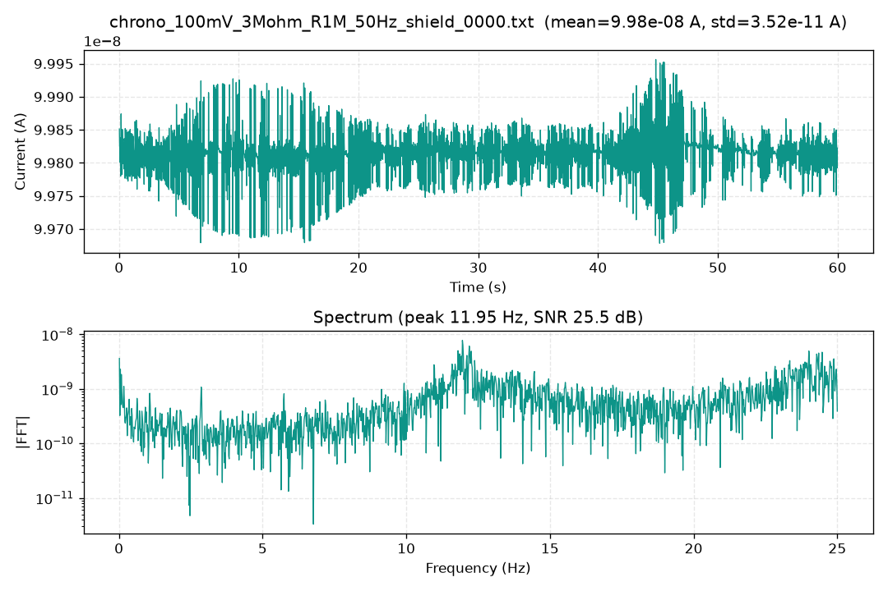
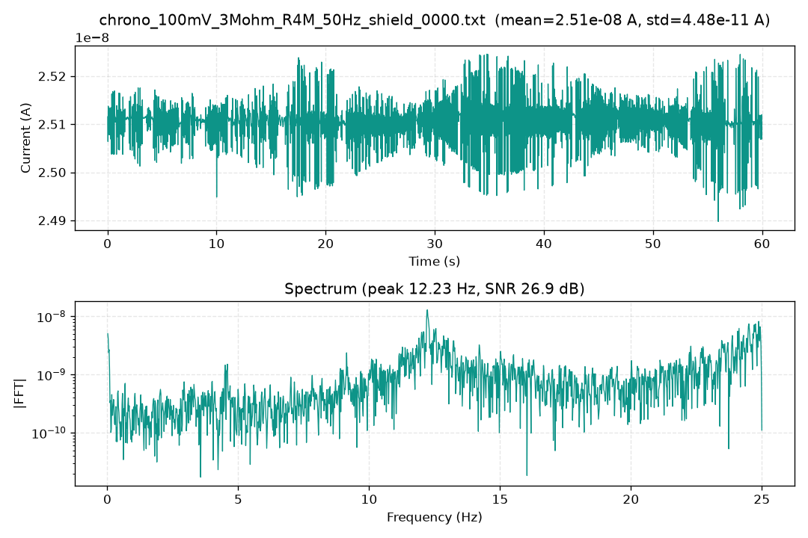
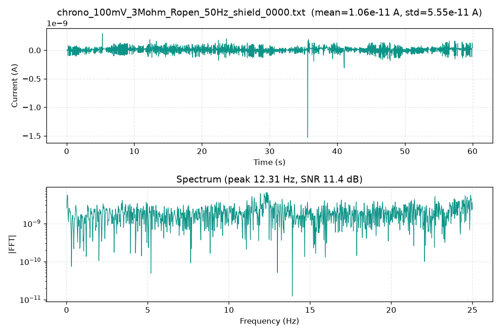
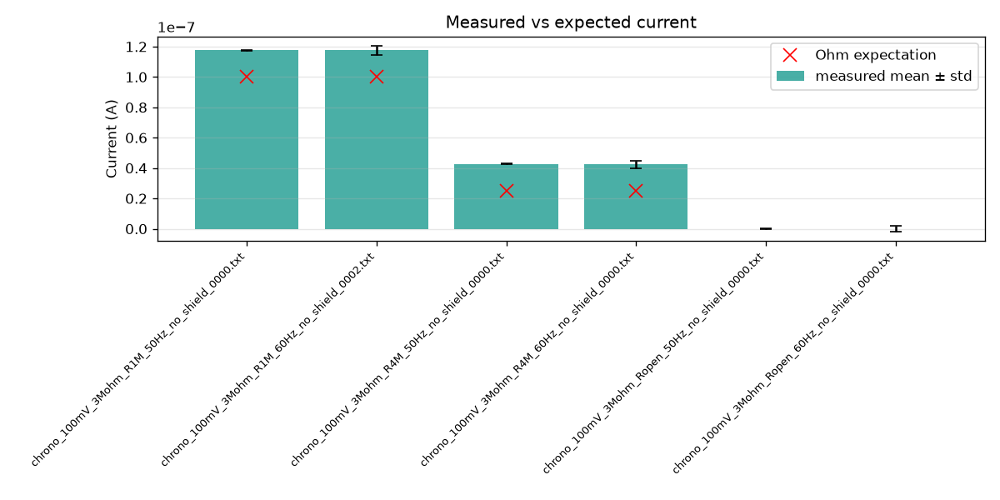
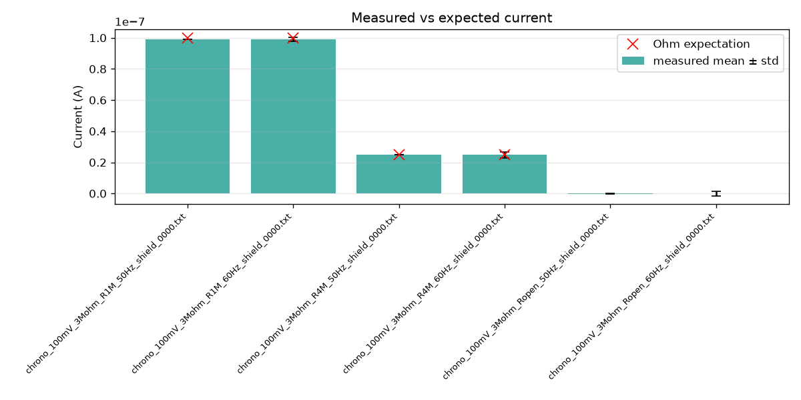

# Ensayos de Cronoamperometría con Celdas Pasivas (Dummy Cell)

Este reporte detalla los experimentos de cronoamperometría ejecutados aplicando un potencial constante de **$V = 100\text{ mV}$** utilizando una ganancia de transimpedancia $R_{TIA} = 3\text{ M}\Omega$.

---

## 🔬 Condiciones Experimentales

Se evaluaron tres configuraciones de carga conectadas entre el electrodo de trabajo (WE) y el contra/referencia (CE/RE):
1. **$R_{\text{test}} = 1\text{ M}\Omega$:** Corriente teórica esperada $I = 100\text{ mV} / 1\text{ M}\Omega = 100.0\text{ nA}$.
2. **$R_{\text{test}} = 4\text{ M}\Omega$:** Corriente teórica esperada $I = 100\text{ mV} / 4\text{ M}\Omega = 25.0\text{ nA}$.
3. **Circuito Abierto ($R_{\text{test}} = \text{Open}$):** Corriente teórica esperada $I = 0.0\text{ nA}$ (evaluación de corriente de polarización / offset de entrada).

Para cada carga, se contrastaron tres escenarios de adquisición:
- **Escenario 1 (`no_clean_no_cal`):** Placa **sin lavar** por ultrasonido (con residuos de flux de soldadura en la PCB), sin blindaje y sin calibración.
- **Escenario 2 (`clean_no_cal`):** Placa **lavada por ultrasonido con alcohol isopropílico (IPA)** para eliminar el flux y las corrientes de fuga parásitas, con blindaje (jaula de Faraday) y sin calibración.
- **Escenario 3 (`clean_cal`):** Placa lavada por ultrasonido con IPA, con blindaje y con calibración de ganancia y offset aplicada en EEPROM.

---

## 📈 1. Escenario 3: Con Blindaje y Calibrado (`clean_cal`)

Este representa el modo óptimo de operación recomendado.

### Gráfica Resumen de Adquisición

### Métricas Obtenidas

| Archivo | $R_{\text{test}}$ | Frecuencia ADC | Puntos | Media Medida | Esperada | Error (%) | Ruido RMS | SNR (dB) |
| :--- | :---: | :---: | :---: | :---: | :---: | :---: | :---: | :---: |
| `chrono_..._R1M_50Hz_shield` | 1 MΩ | 50 Hz | 2932 | 99.82 nA | 100.0 nA | **-0.18 %** | 35.2 pA | 25.5 dB |
| `chrono_..._R1M_60Hz_shield` | 1 MΩ | 60 Hz | 3519 | 99.82 nA | 100.0 nA | **-0.18 %** | 2.00 nA | 61.9 dB |
| `chrono_..._R4M_50Hz_shield` | 4 MΩ | 50 Hz | 2932 | 25.11 nA | 25.0 nA | **+0.43 %** | 44.8 pA | 26.9 dB |
| `chrono_..._R4M_60Hz_shield` | 4 MΩ | 60 Hz | 3519 | 25.10 nA | 25.0 nA | **+0.42 %** | 2.36 nA | 66.6 dB |
| `chrono_..._Ropen_50Hz_shield` | Open | 50 Hz | 2932 | 10.6 pA | 0.0 nA | **N/A** | 55.5 pA | 11.4 dB |
| `chrono_..._Ropen_60Hz_shield` | Open | 60 Hz | 3518 | 11.6 pA | 0.0 nA | **N/A** | 2.04 nA | 62.2 dB |

### Análisis Detallado por Resistencia (50 Hz)

#### Carga 1 MΩ (100 mV)

- Corriente media observada: **99.82 nA** frente a los 100.0 nA ideales.
- Error absoluto: **-0.18 nA** (-0.18%).
- Ruido pico a pico residual: **0.278 nA**.

#### Carga 4 MΩ (100 mV)

- Corriente media observada: **25.11 nA** frente a los 25.0 nA ideales.
- Error absoluto: **+0.11 nA** (+0.43%).
- Ruido pico a pico residual: **0.348 nA**.

#### Circuito Abierto (Open)

- Corriente de offset residual en reposo: **~10.6 pA**.

---

## 🧼 2. Comparación Crítica: Limpieza por Ultrasonido (Flux) y Blindaje vs. Placa Sin Lavar

> [!IMPORTANT]
> **Hallazgo Experimental Fundamental:**  
> La diferencia entre `no_clean` y `clean` corresponde al paso de la PCB por una **batea de ultrasonido con alcohol isopropílico (IPA)** para eliminar residuos de flux de soldadura. Este proceso tuvo el impacto más drástico en la exactitud de medición, superando ampliamente el efecto del apantallamiento en corriente continua.

Los residuos de flux de soldadura sobre la superficie de la PCB actúan como vías de conducción parásita microscópicas entre pistas contiguas a distintos potenciales. En etapas analógicas de alta impedancia (como el nodo de entrada del amplificador de transimpedancia TIA), estas fugas introducen una **corriente de fuga parásita continua de aproximadamente 17 a 18 nA**:

- En la carga de **1 MΩ** ($I_{\text{nominal}} = 100\text{ nA}$), la fuga elevó la corriente medida a **117.5 nA** (+17.50% de error).
- En la carga de **4 MΩ** ($I_{\text{nominal}} = 25\text{ nA}$), la misma fuga de corriente elevó el valor medido a **42.73 nA**, representando un error masivo de **+70.92%**.

Al someter la placa a **lavado por ultrasonido con IPA (`clean`)**, el flux se disolvió completamente y las corrientes de fuga desaparecieron, desplomando el error de inmediato a **menos del 1%**:

| Configuración | Carga Nominal | Corriente Teórica | Sin Lavar + Sin Blindaje (`no_clean_no_cal`) | Lavada IPA + Con Blindaje (`clean_no_cal`) | Error Sin Lavar | Error Con Lavado IPA |
| :--- | :---: | :---: | :---: | :---: | :---: | :---: |
| **R = 1 MΩ** | 1 MΩ | 100.0 nA | 117.5 nA | 99.16 nA | **+17.50 %** | **-0.84 %** |
| **R = 4 MΩ** | 4 MΩ | 25.0 nA | 42.73 nA | 24.83 nA | **+70.92 %** | **-0.66 %** |

### Gráficas Comparativas

#### Placa Sin Lavar (Con Flux) y Sin Blindaje (`no_clean_no_cal`)

*Nótese el desplazamiento masivo de la corriente media debido a las corrientes de fuga parásitas que atraviesan los restos de flux conductor en la superficie de la PCB.*

#### Placa Lavada por Ultrasonido con IPA y Con Blindaje (`clean_no_cal`)

*Tras la remoción completa del flux mediante ultrasonido con alcohol isopropílico, la corriente de fuga se anula y la celda blindada arroja lecturas con error inferior al 1%, incluso antes de calibrar por software.*

---

## ⚡ 3. Efecto de la Frecuencia del Filtro ADC (50 Hz vs 60 Hz)

En regiones donde la red de distribución eléctrica es de **50 Hz** (por ejemplo, Argentina y Europa):
- Configurar el conversor a **50 Hz** activa el filtro sincrónico tipo peine (*comb filter / notch*) en los armónicos de 50 Hz.
- El ruido RMS cae de **~2 nA** (a 60 Hz) a tan solo **~35 pA** (a 50 Hz), logrando una reducción de ruido de más de un orden de magnitud.

---

## 💡 Conclusiones Operativas

1. **Limpieza por ultrasonido obligatoria:** El paso de la PCB por batea de ultrasonido con alcohol isopropílico (IPA) de alta pureza es **absolutamente crítico**. Sin esta limpieza, los residuos de flux actúan como resistencias parásitas en paralelo que falsean completamente las mediciones de corrientes sub-microamperio (errores superiores al 70%).
2. **Uso de blindaje electrostático:** La jaula de Faraday y cables apantallados son esenciales para suprimir el acople capacitivo de la red de corriente alterna (ruido de línea AC), garantizando pisos de ruido en el rango de los picoamperios.
3. **Selección de frecuencia de red (50/60 Hz):** Debe coincidir siempre con la red local para aprovechar el notch analógico-digital del ADC ADS1255.
4. **Calibración fina:** Corrige las tolerancias intrínsecas de los resistores de retroalimentación del TIA, reduciendo el error global de lectura al orden de **±0.2% a ±0.4%**.
