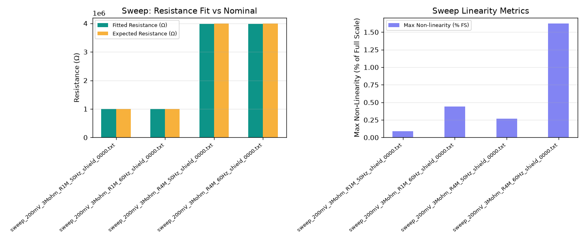
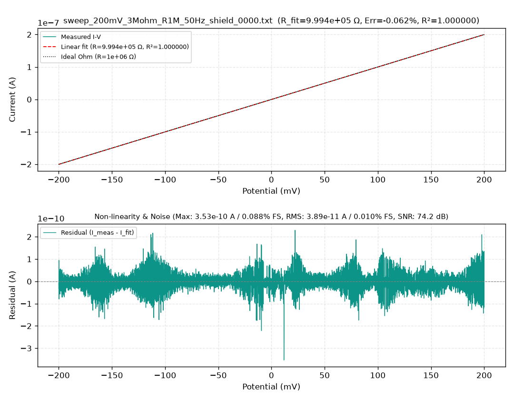
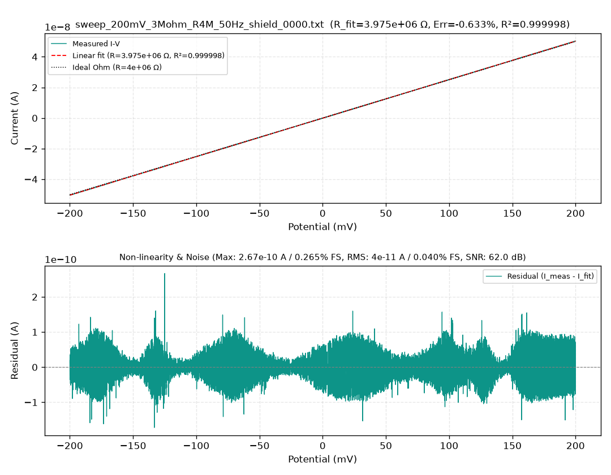

# Ensayos de Barrido Lineal de Potencial (Linear Sweep / CV)

Este reporte presenta la validación dinámica y linealidad del sistema de adquisición de **DStat-RD** durante barridos continuos de potencial entre **$-200\text{ mV}$ y $+200\text{ mV}$**.

---

## 🎯 Metodología

Se aplicó una rampa lineal simétrica de potencial sobre resistencias patrón de precisión conectadas como celda dummy:
- **Resistencia 1:** $R_{\text{nominal}} = 1\text{ M}\Omega$
- **Resistencia 2:** $R_{\text{nominal}} = 4\text{ M}\Omega$
- **Ganancia TIA utilizada:** $R_{TIA} = 3\text{ M}\Omega$
- **Condición ambiental:** Celda blindada (*shielded*) con rechazo configurado a 50 Hz y 60 Hz.

### Modelo de Ajuste
De acuerdo a la Ley de Ohm:
$$I(V) = G \cdot V + I_{\text{offset}} = \frac{1}{R_{\text{fit}}} \cdot V + I_{\text{offset}}$$

A partir de la regresión lineal por mínimos cuadrados ordinarios, se obtienen:
- **Conductancia medida ($G$, en Siemens) y Resistencia equivalente ($R_{\text{fit}} = 1 / G$).**
- **Corriente de offset ($I_{\text{offset}}$):** Valor de corriente registrado para $V = 0\text{ V}$.
- **Coeficiente de determinación ($R^2$):** Bondad del ajuste lineal.
- **Error de no linealidad (% FS):** Máxima desviación del valor ajustado respecto al fondo de escala.
- **Ruido RMS:** Desvío estándar de los residuos de la regresión.

---

## 📊 Gráfica Resumen General

---

## 📋 Tabla de Métricas de Ajuste

| Archivo | $R_{\text{exp}}$ | Rango de Tensión | $R_{\text{fit}}$ Calculada | Error en $R$ | Offset ($I_0$) | $R^2$ | No Linealidad (% FS) | Ruido RMS | SNR (dB) |
| :--- | :---: | :---: | :---: | :---: | :---: | :---: | :---: | :---: |
| `sweep_..._R1M_50Hz_shield` | 1 MΩ | -200 a +200 mV | **999.4 kΩ** | **-0.06 %** | -0.23 nA | **1.000000** | **0.088 %** | 38.9 pA | **74.2 dB** |
| `sweep_..._R1M_60Hz_shield` | 1 MΩ | -200 a +200 mV | **999.4 kΩ** | **-0.06 %** | -0.22 nA | **0.999929** | 0.439 % | 0.97 nA | 46.3 dB |
| `sweep_..._R4M_50Hz_shield` | 4 MΩ | -200 a +200 mV | **3.975 MΩ** | **-0.63 %** | -0.06 nA | **0.999998** | **0.265 %** | 40.0 pA | **62.0 dB** |
| `sweep_..._R4M_60Hz_shield` | 4 MΩ | -200 a +200 mV | **3.975 MΩ** | **-0.64 %** | -0.06 nA | **0.999035** | 1.625 % | 0.90 nA | 35.2 dB |

---

## 🔍 Análisis por Curva Experimental

### 1. Barrido sobre Resistencia de 1 MΩ (Filtro 50 Hz)

- **Resistencia ajustada:** $999.38\text{ k}\Omega$ (error de tan solo **-0.06%** respecto a 1 MΩ).
- **Linealidad:** $R^2 = 1.000000$ en todo el rango de $\pm 200\text{ mV}$.
- **Desviación máxima:** Menor a $0.09\%$ del fondo de escala.
- **Relación Señal/Ruido (SNR):** **74.2 dB**.

### 2. Barrido sobre Resistencia de 4 MΩ (Filtro 50 Hz)

- **Resistencia ajustada:** $3.975\text{ M}\Omega$ (error de **-0.63%**).
- **Linealidad:** $R^2 = 0.999998$.
- **Error RMS residual:** $40\text{ pA}$.
- **Relación Señal/Ruido (SNR):** **62.0 dB**.

---

## 💡 Conclusiones Técnicas

1. **Alta Linealidad del DAC/ADC:** El coeficiente $R^2 > 0.99999$ confirma que la rampa generada por el conversor digital-analógico y la adquisición del convertidor sigma-delta no introducen distorsiones armónicas ni histéresis apreciables en el rango de potenciales analizado.
2. **Excelente Precisión de Corriente:** Con errores de resistencia ajustada por debajo del 0.7%, se valida la aptitud del circuito de entrada para realizar barridos analíticos precisos (LSV, CV, DPV).
3. **Mínimo Offset de Cero:** La corriente de cruce por cero ($V = 0\text{ V}$) se mantiene en magnitudes menores a $250\text{ pA}$, demostrando la adecuada polarización de los amplificadores operacionales de instrumentación.
