# Solución de Problemas (Troubleshooting) - DStat-RD

Guía de resolución de fallas frecuentes en hardware, firmware y software.

---

## 🔍 Problemas Comunes y Soluciones

### 1. El puerto serie no aparece o figura con error (Triángulo Amarillo en Windows)
- **Causas comunes:**
  - Cable USB defectuoso o de solo carga (sin líneas D+/D-).
  - Windows no asignó automáticamente el controlador serie CDC ACM correspondiente al microcontrolador AVR/XMega.
- **Acción inicial:** Comprobar que el cable USB transmita datos. En Linux, verificar con `ls /dev/ttyACM*` o `dmesg | tail`. En Windows, abrir el **Administrador de Dispositivos** (`devmgmt.msc`) y seguir la guía detallada a continuación si el dispositivo figura con un triángulo amarillo.

---

## 🛠️ Procedimiento: Solución de Controlador COM en Windows

Si al conectar el potenciostato Windows muestra una advertencia en el puerto serie, seguir estos pasos para forzar la asignación del controlador correcto:

### Paso 1: Identificar el dispositivo en conflicto
En el **Administrador de dispositivos**, desplegar la categoría **Puertos (COM y LPT)**. El instrumento figurará como `AVR MEGA Virtual Com Port (COMxx)` acompañado de un icono triangular amarillo de advertencia.

  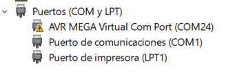

---

### Paso 2: Iniciar actualización de controlador
Hacer clic derecho sobre el dispositivo con advertencia y seleccionar **Actualizar controlador**.

  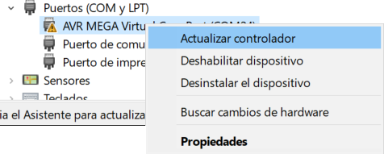

---

### Paso 3: Buscar controladores en el equipo
En la ventana del asistente, hacer clic sobre la opción **Examinar mi PC en busca de controladores** (búsqueda e instalación manual).

  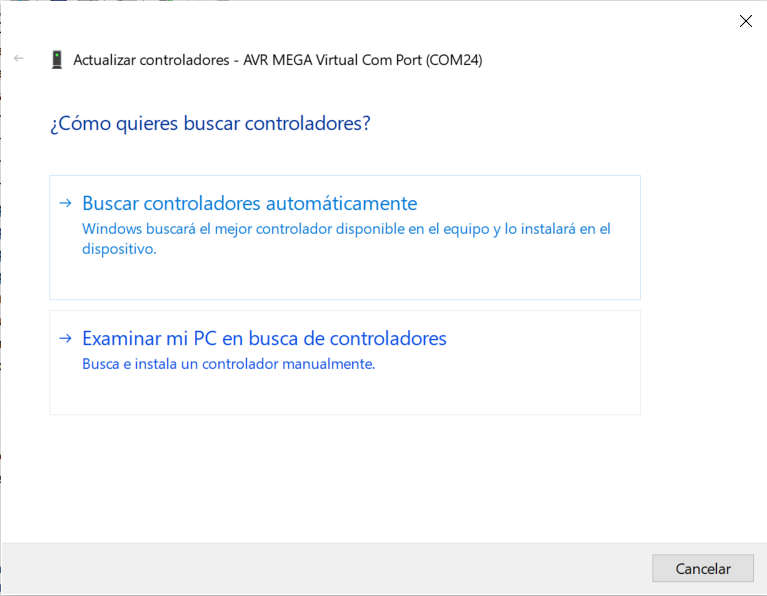

---

### Paso 4: Elegir desde la lista de controladores disponibles
Seleccionar la opción inferior: **Elegir en una lista de controladores disponibles en el equipo**.

  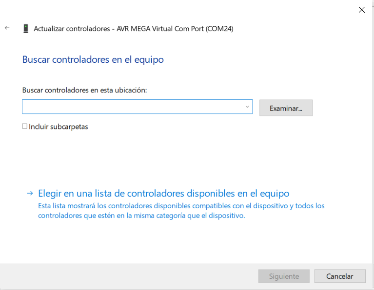

---

### Paso 5: Seleccionar el controlador compatible
Asegurarse de que esté marcada la casilla **Mostrar el hardware compatible**. En la lista de modelos, seleccionar **AVR MEGA Virtual Com Port** y presionar **Siguiente**.

  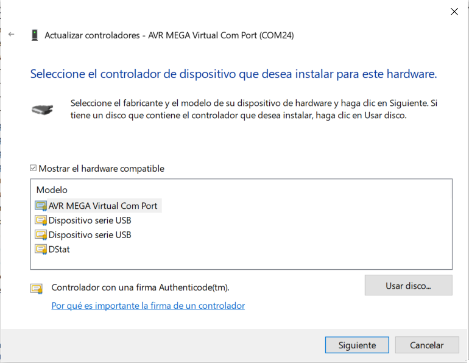

---

### Paso 6: Confirmación de instalación
Windows completará el enlace del controlador y desplegará el mensaje *"Windows actualizó correctamente los controladores"*. Presionar **Cerrar**.

  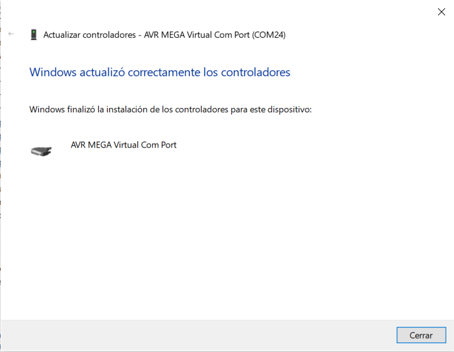

---

### Paso 7: Verificación final
En el Administrador de dispositivos, el puerto figurará activo y sin signos de advertencia (`AVR MEGA Virtual Com Port (COMxx)`). El instrumento ya se encuentra listo para ser seleccionado en la GUI de DStat.

  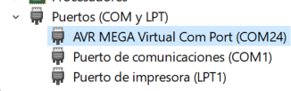

---

### 2. El microcontrolador queda bloqueado en modo DFU

- **Síntoma en Windows:** En el Administrador de dispositivos no figura ningún puerto COM, sino una entrada bajo **Microchip Tools** (o *Atmel USB Devices*) identificada como **`ATxmega256A3U`**:

  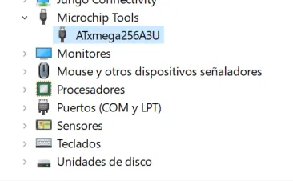

- **Causa:** El firmware principal no arranca (firmware corrupto o memoria borrada), o la línea de selección de bootloader quedó retenida en nivel bajo (forzando el arranque del bootloader USB de fábrica).
- **Acción:** Seguir el procedimiento de flasheo con **Atmel FLIP** descripto a continuación.

---

## ⚡ Procedimiento: Reflasheo de Firmware con Atmel FLIP

> **Prerequisito:** Tener instalado [Atmel FLIP](https://www.microchip.com/developmenttools/ProductDetails/flip) (versión 3.4.7 o superior) y el driver DFU de Atmel (incluido en la instalación de FLIP). El equipo debe estar conectado por USB y visible en el Administrador de dispositivos como `ATxmega256A3U` bajo *Microchip Tools*.

### Paso 1: Seleccionar el dispositivo objetivo

Abrir **Atmel FLIP**. En la barra de herramientas, hacer clic en el icono de **Device Selection** (chip con lupa, primer ícono) o ir a **Device → Select**. En la lista desplegable, seleccionar **`ATxmega256A3U`** y presionar **Aceptar**.

  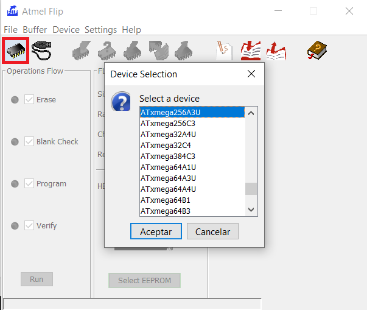

---

### Paso 2: Conectar por USB (DFU)

Hacer clic en el ícono de **Communication Medium** (cable con conector, segundo ícono de la barra) o ir al menú **Settings → Communication → USB** (`Ctrl+U`).

  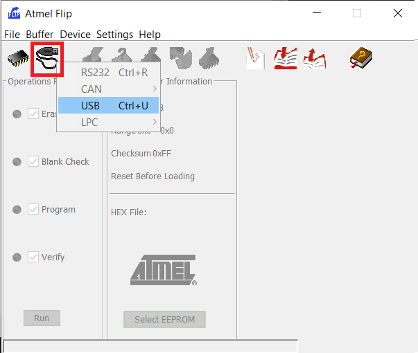

FLIP intentará conectarse al dispositivo en modo DFU. Si el diálogo se cierra sin error, la conexión fue exitosa y el panel *FLASH Buffer Information* comenzará a mostrar datos del chip.

> **⚠️ Si la conexión falla:** Verificar que el driver DFU de Atmel esté correctamente instalado para el dispositivo `ATxmega256A3U`. En el Administrador de dispositivos, el dispositivo debe aparecer bajo *Microchip Tools* (no como dispositivo desconocido).

---

### Paso 3: Cargar el archivo de firmware (.hex)

Ir al menú **File → Load HEX File...** (`Ctrl+L`).

  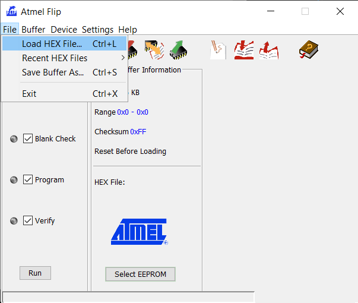 Load HEX File en FLIP" width="500" />

En el explorador de archivos, navegar hasta la carpeta del firmware y seleccionar el archivo `dstat-firmware.hex`. Presionar **OK**.

  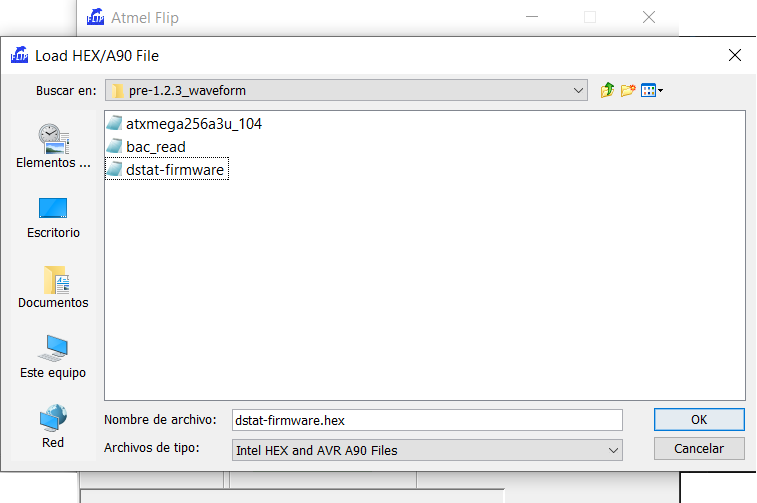

Una vez cargado, el panel **FLASH Buffer Information** mostrará:
- `Size`: tamaño total de la memoria flash del chip (256 KB para el ATxmega256A3U).
- `Range`: rango de direcciones ocupadas por el firmware (ej. `0x0 – 0x93AD`).
- `Checksum`: hash de integridad del archivo cargado.
- `HEX File`: nombre del archivo y tamaño en bytes útiles.

---

### Paso 4: Ejecutar el flujo de programación

Verificar que en el panel **Operations Flow** del lado izquierdo estén marcadas las opciones:
- ✅ **Erase** — Borrar la memoria flash antes de escribir.
- ✅ **Blank Check** — Verificar que la memoria esté en blanco antes de programar.
- ✅ **Program** — Escribir el firmware en la memoria.
- ✅ **Verify** — Confirmar que los datos escritos coincidan con el archivo fuente.

Presionar el botón **Run** para iniciar la secuencia completa.

  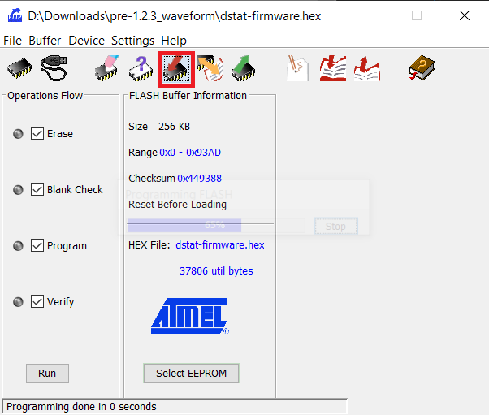

La barra de estado inferior mostrará el progreso y, al finalizar exitosamente: **`Programming done in 0 seconds`** (o el tiempo real que tome). El firmware ha sido grabado correctamente.

---

### Paso 5: Reiniciar el instrumento

Desconectar y volver a conectar el cable USB. El microcontrolador arrancará ahora con el firmware nuevo y el dispositivo aparecerá en el Administrador de dispositivos como `AVR MEGA Virtual Com Port (COMxx)`, listo para ser utilizado con la GUI de DStat.

> **💡 Tip:** Si después del reflasheo Windows no reconoce el nuevo puerto COM, seguir el [Procedimiento de Solución de Controlador COM en Windows](#-procedimiento-solución-de-controlador-com-en-windows) documentado más arriba.

### 3. Mediciones con exceso de ruido de 50/60 Hz
- **Causa:** Interferencia capacitiva o inductiva de la red eléctrica en los cables de los electrodos.
- **Acción:**
  - Utilizar cables coaxiales o blindados para el electrodo de trabajo (WE).
  - Alojar la celda electroquímica dentro de una caja metálica conectada a masa (Jaula de Faraday).
  - Verificar que la fuente de alimentación no introduzca rizado excesivo.

### 4. Lecturas saturadas o en fondo de escala
- **Causa:** Rango de ganancia TIA demasiado alto para la corriente generada, o circuito abierto en los electrodos.
- **Acción:** Seleccionar un rango de corriente más amplio en la GUI o revisar la continuidad física de los electrodos en la solución.

### 5. Desvío constante de corriente u offset elevado en corrientes bajas (nanoamperios)
- **Causa:** Residuos de flux de soldadura en la superficie de la PCB. El flux crea caminos de conducción parásitos microscópicos que introducen fugas de corriente continua de hasta 15–20 nA hacia los nodos de alta impedancia del TIA.
- **Acción:**
  - Desmontar la PCB y realizar un **lavado por ultrasonido con alcohol isopropílico (IPA)** de pureza ≥ 99.5% durante 5 a 10 minutos.
  - Secar minuciosamente con aire comprimido limpio y tibio antes de volver a energizar.
  - En los ensayos experimentales de DStat-RD, este lavado eliminó las corrientes de fuga, reduciendo el error en resistencias de 4 MΩ del **+70.9%** a **-0.66%** (ver [Reporte de Caracterización](./characterization/chronoamperometry.md)).
