# Manual de Usuario — DStat-RD GUI v2.1

Guía completa de instalación, interfaz y operación del potenciostato mediante la interfaz gráfica de usuario.

---

## Tabla de Contenidos

1. [Requisitos e Instalación](#1-requisitos-e-instalación)
2. [Layout de la Ventana Principal](#2-layout-de-la-ventana-principal)
3. [Panel de Comunicaciones](#3-panel-de-comunicaciones)
4. [Configuración del ADC](#4-configuración-del-adc)
5. [Configuración del Potenciostato (Ganancia TIA)](#5-configuración-del-potenciostato-ganancia-tia)
6. [Panel de Experimento](#6-panel-de-experimento)
7. [Preacondicionamiento](#7-preacondicionamiento)
8. [Control de Ejecución](#8-control-de-ejecución)
9. [Visualización de Datos](#9-visualización-de-datos)
10. [Guardado y Exportación](#10-guardado-y-exportación)
11. [Autosave](#11-autosave)
12. [Calibración y Configuración del Dispositivo](#12-calibración-y-configuración-del-dispositivo)
13. [Análisis Post-Adquisición](#13-análisis-post-adquisición)
14. [Terminal de Protocolo (Protocol Terminal)](#14-terminal-de-protocolo-protocol-terminal)
15. [Referencia de Técnicas Electroquímicas](#15-referencia-de-técnicas-electroquímicas)
16. [Límites del Hardware y Validación](#16-límites-del-hardware-y-validación)
17. [Menús de la Aplicación y Atajos](#17-menús-de-la-aplicación-y-atajos)
18. [Flujo de Trabajo Típico (Paso a Paso)](#18-flujo-de-trabajo-típico-paso-a-paso)
19. [Integración con Microfluídica (DropBot)](#19-integración-con-microfluídica-dropbot)
20. [Diagnóstico Rápido de Señales Anómalas](#20-diagnóstico-rápido-de-señales-anómalas)
21. [Documentación y Enlaces Relacionados](#21-documentación-y-enlaces-relacionados)

---

## 1. Requisitos e Instalación

### Requisitos de sistema
- Python 3.10 o superior.
- Paquetes Python: `PyQt6`, `numpy`, `matplotlib`, `pyserial`, `pyyaml`.
- Driver USB CDC ACM instalado (ver [Troubleshooting](./troubleshooting.md) si el puerto COM no aparece).

### Instalación y arranque

```bash
cd gui
pip install -r requirements.txt
python -m dstat_interface.main
```

<!-- CAPTURA: Ventana principal completa con todas las secciones visibles -->
<p align="center">
  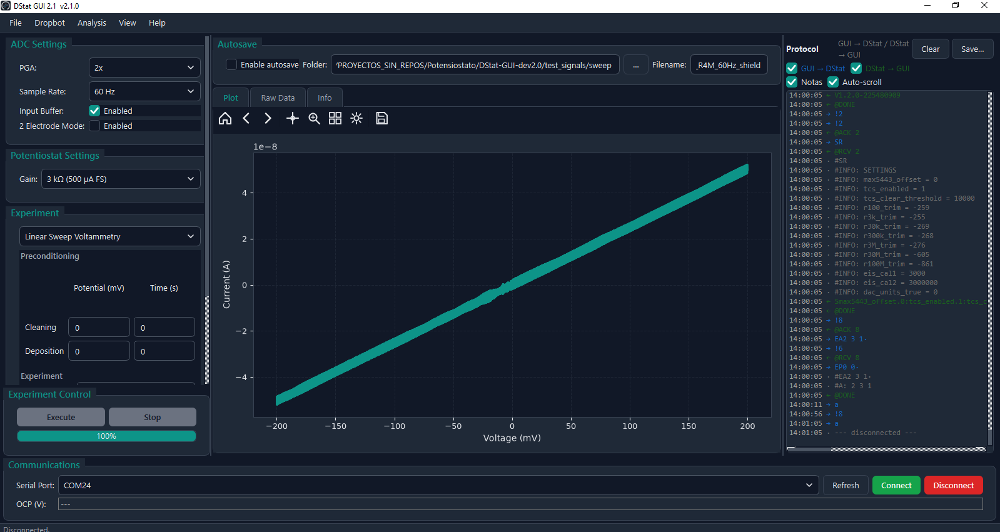
</p>

---

## 2. Layout de la Ventana Principal

La ventana principal (`DStat GUI 2.1 v2.1.0`) está organizada en tres columnas horizontales separadas por divisores redimensionables:

```
┌─────────────────────┬───────────────────────┬─────────────────────┐
│   COLUMNA IZQUIERDA │   COLUMNA CENTRAL     │   COLUMNA DERECHA   │
│                     │                       │                     │
│ • ADC Settings      │ • Autosave bar        │ Protocol Terminal   │
│ • Potentiostat      │ • Tabs:               │  (log serial)       │
│   Settings (Gain)   │   - Plot              │                     │
│ • Experiment panel  │   - Raw Data          │                     │
│   (técnica + params)│   - Info              │                     │
├─────────────────────┴───────────────────────┴─────────────────────┤
│                  Experiment Control (Execute / Stop / Progress)    │
├───────────────────────────────────────────────────────────────────┤
│         Communications (Puerto COM, Connect, Disconnect, OCP)     │
└───────────────────────────────────────────────────────────────────┘
```

Las columnas pueden redimensionarse arrastrando los separadores. La columna derecha (Protocol Terminal) puede ocultarse desde **View → Protocol Terminal** (`Ctrl+P`).

---

## 3. Panel de Comunicaciones

> Se ubica en la barra inferior de la ventana.

<!-- CAPTURA: Panel Communications con el combo de puerto, botones y campo OCP -->
<p align="center">
  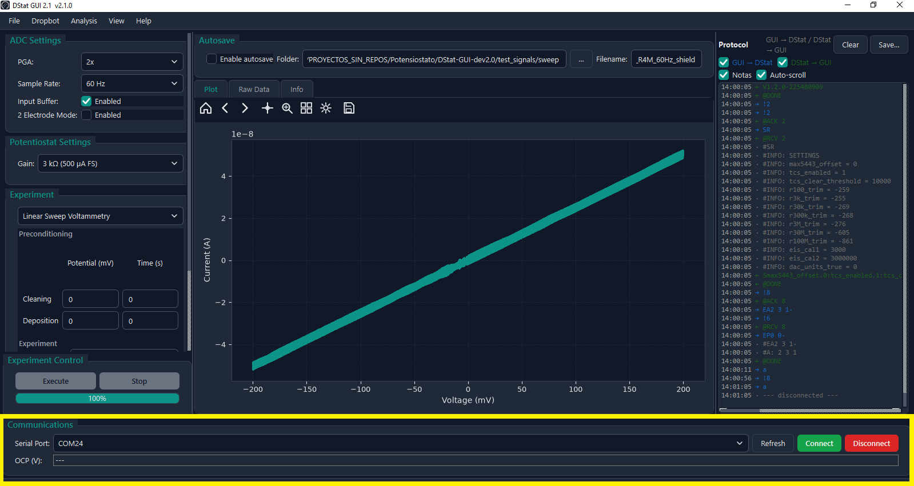
</p>

| Control | Función |
|---------|---------|
| **Serial Port** (combo) | Lista de puertos COM disponibles detectados automáticamente. |
| **Refresh** | Vuelve a escanear los puertos serie disponibles. Útil si se conectó el instrumento después de abrir la aplicación. |
| **Connect** | Establece la conexión serie, identifica la placa y lee los parámetros de calibración desde la EEPROM. |
| **Disconnect** | Cierra la conexión de forma ordenada. |
| **OCP (V)** | Muestra el potencial de circuito abierto en tiempo real (actualización cada 500 ms). Se detiene al ejecutar un experimento y se reanuda al terminar. Requiere firmware v1.2 o superior; en versiones anteriores muestra `n/a`. |

La **barra de estado** inferior muestra el estado de la conexión y mensajes de progreso o error.

---

## 4. Configuración del ADC

> Panel **ADC Settings** en la columna izquierda.

<!-- CAPTURA: Grupo ADC Settings con los cuatro controles visibles -->
<p align="center">
  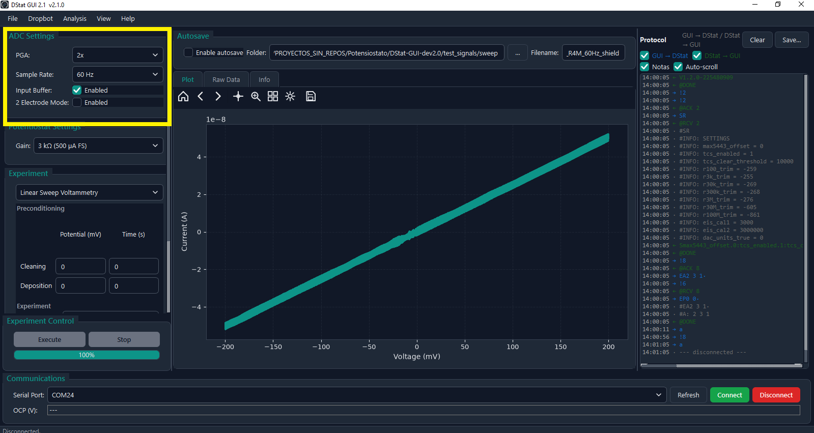
</p>

| Control | Opciones / Rango | Descripción |
|---------|-----------------|-------------|
| **PGA** | 1×, 2×, 4×, 8×, 16×, 32×, 64× | Ganancia del amplificador de programmable del ADC ADS1255. Valores altos mejoran la resolución pero reducen el rango de entrada. **Default: 2×.** |
| **Sample Rate** | 2.5 Hz a 30 kHz (16 opciones) | Frecuencia de muestreo del ADC. Para rechazo de red usar **50 Hz** (Argentina/Europa) o **60 Hz** (América del Norte). Tasas bajas reducen ruido de cuantificación. **Default: 60 Hz.** |
| **Input Buffer** | Habilitado / Deshabilitado | Habilita el buffer de entrada del ADC, que incrementa la impedancia de entrada. **Debe estar habilitado** en la mayoría de las mediciones. |
| **2 Electrode Mode** | Habilitado / Deshabilitado | Cortocircuita los terminales CE y RE internamente. Usar solo con celdas de 2 electrodos. |

> **💡 Consejo:** Para cronoamperometría de alta precisión con electrodos en solución acuosa, usar Sample Rate = 50 Hz (en redes de 50 Hz) con PGA = 2× y buffer habilitado.

---

## 5. Configuración del Potenciostato (Ganancia TIA)

> Panel **Potentiostat Settings** en la columna izquierda.

<!-- CAPTURA: Panel Potentiostat Settings mostrando el combo Gain -->
<p align="center">
  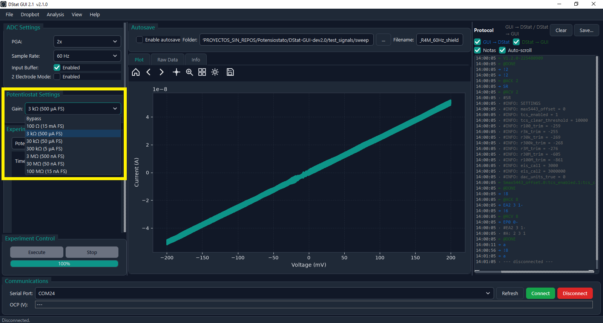
</p>

| Control | Descripción |
|---------|-------------|
| **Gain** (combo) | Selecciona el rango de corriente activo mediante la resistencia de retroalimentación del amplificador de transimpedancia (TIA). Las opciones se cargan desde la EEPROM del instrumento al conectar. Los valores disponibles son: 100 Ω, 3 kΩ, 30 kΩ, 300 kΩ, 3 MΩ, 30 MΩ, 100 MΩ. |

La relación entre ganancia y escala de corriente medible es aproximadamente:

| Resistencia TIA | Fondo de escala (aprox.) |
|:---:|:---:|
| 100 Ω | ~20 mA |
| 3 kΩ | ~700 µA |
| 30 kΩ | ~70 µA |
| 300 kΩ | ~7 µA |
| 3 MΩ | ~700 nA |
| 30 MΩ | ~70 nA |
| 100 MΩ | ~20 nA |

> **⚠️ Importante:** Si la lectura aparece saturada o en fondo de escala, reducir la resistencia TIA (elegir un valor de ganancia menor). Si el ruido es demasiado grande relativo a la señal, incrementar la resistencia (mayor ganancia).

---

## 6. Panel de Experimento

> Panel **Experiment** en la columna izquierda, con un combo de selección de técnica en la parte superior.

<!-- CAPTURA: Panel Experiment con la técnica CV seleccionada -->
<p align="center">
  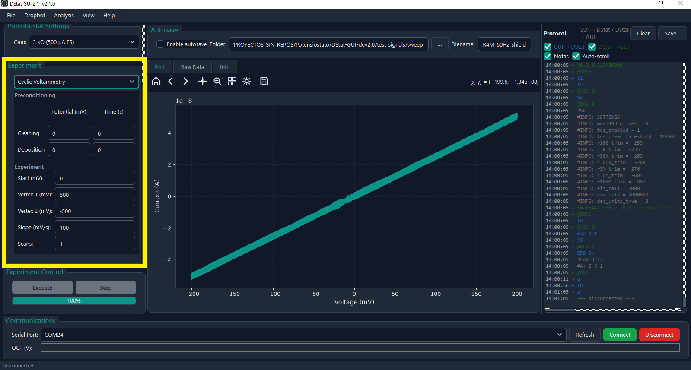
</p>

### Selección de Técnica

El combo desplegable permite seleccionar una de las siguientes técnicas:

| Técnica | Descripción breve |
|---------|------------------|
| **Cyclic Voltammetry (CV)** | Barrido triangular de potencial, múltiples ciclos. Resultado: I vs. V. |
| **Linear Sweep Voltammetry (LSV)** | Barrido lineal unidireccional. Resultado: I vs. V. |
| **Square Wave Voltammetry (SWV)** | Barrido con onda cuadrada superpuesta. Resultado: I neta, directa e inversa vs. V. |
| **Differential Pulse Voltammetry (DPV)** | Pulsos diferenciales sobre rampa. Resultado: ΔI vs. V. |
| **Chronoamperometry (CA)** | Escalones de potencial fijos. Resultado: I vs. t. |
| **Potentiometry** | Sin corriente aplicada. Resultado: V vs. t (OCP continuo). |

Al cambiar la técnica, el panel de parámetros debajo del combo se actualiza automáticamente mostrando los campos específicos de cada técnica.

> **Ver sección [15. Referencia de Técnicas](#15-referencia-de-técnicas-electroquímicas)** para la descripción detallada de parámetros, rangos típicos y aplicaciones de cada técnica.

---

## 7. Preacondicionamiento

> Disponible en CV, LSV y SWV. Aparece como grupo colapsable dentro del panel de cada técnica.

<!-- CAPTURA: Subgrupo Preconditioning con campos Cleaning y Deposition -->
<p align="center">
  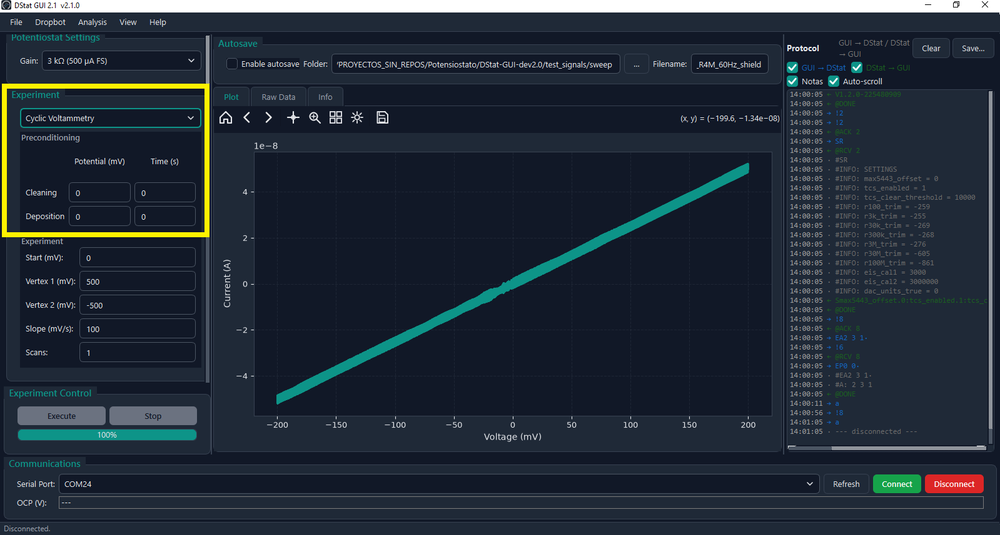
</p>

El preacondicionamiento se ejecuta **automáticamente antes** del experimento principal. Tiene dos etapas independientes configurables:

| Etapa | Parámetros | Propósito |
|-------|-----------|-----------|
| **Cleaning** | Potential (mV), Time (s) | Aplica un potencial fijo para limpiar u oxidar/reducir la superficie del electrodo antes de la medición. |
| **Deposition** | Potential (mV), Time (s) | Deposita el analito sobre el electrodo (preconcentración). Fundamental para análisis de trazas con SWV. |

Dejar ambos campos de tiempo en `0` deshabilita esa etapa completamente.

---

## 8. Control de Ejecución

> Panel **Experiment Control** en la parte inferior de la columna izquierda.

<!-- CAPTURA: Panel Experiment Control con botones Execute, Stop y barra de progreso -->
<p align="center">
  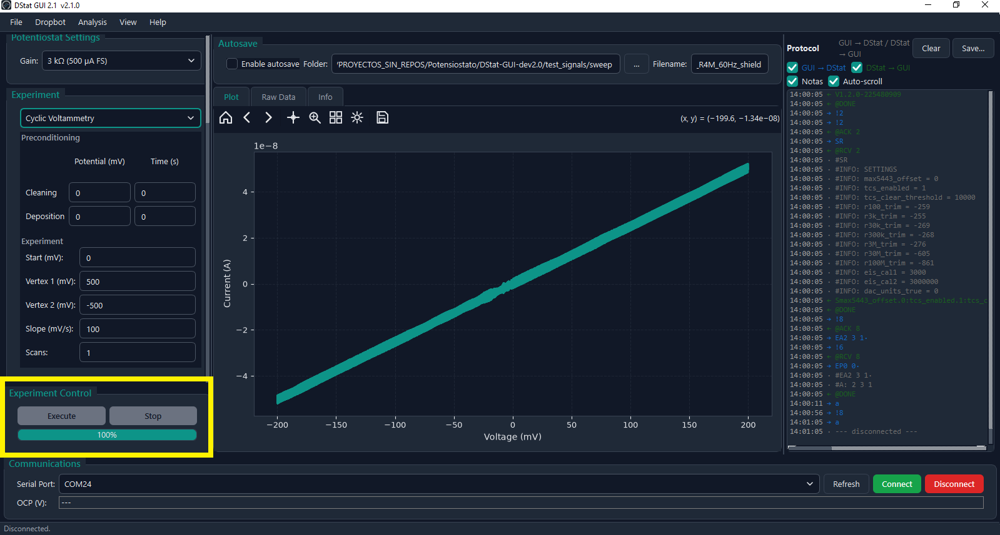
</p>

| Control | Estado inicial | Función |
|---------|---------------|---------|
| **Execute** | Deshabilitado (hasta conectar) | Inicia el experimento con los parámetros actuales. Se habilita al establecer la conexión serie. |
| **Stop** | Deshabilitado | Detiene el experimento en curso de forma ordenada. |
| **Barra de progreso** | 0 % | Refleja el avance del experimento activo. Se actualiza en tiempo real durante la adquisición. |

---

## 9. Visualización de Datos

> Tabs en la columna central: **Plot**, **Raw Data**, **Info**.

### Tab Plot
Muestra el gráfico en tiempo real durante la adquisición. El eje X y el eje Y se ajustan automáticamente según la técnica:
- **CV / LSV / SWV / DPV:** Potencial (mV o V) vs. Corriente (A o µA).
- **CA / Potentiometry:** Tiempo (s) vs. Corriente (A) o Tensión (V).

<p align="center">
  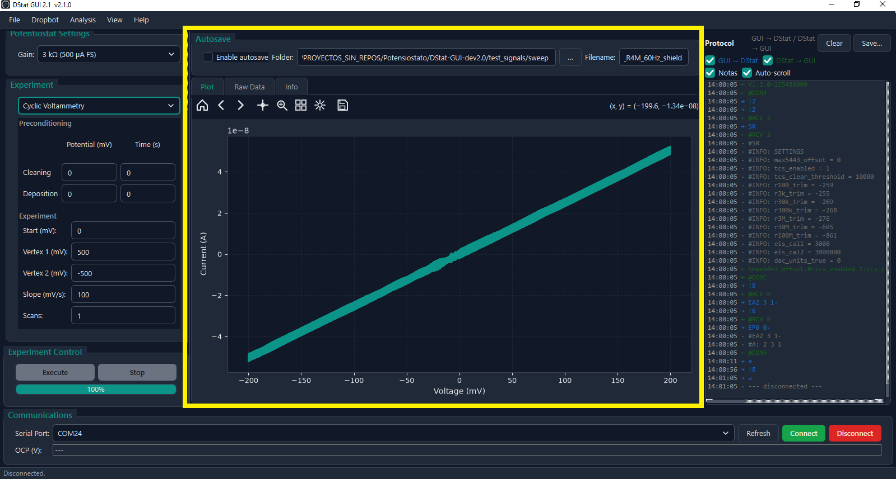
</p>

La barra de herramientas embebida de Matplotlib permite:
- Zoom (rectángulo o scroll).
- Paneo con click-drag.
- Resetear la vista a los datos.
- Guardar el gráfico directamente.

### Tab Raw Data
Tabla numérica con los datos crudos en columnas de tiempo/potencial y corriente, tal como son recibidos del instrumento.

<p align="center">
  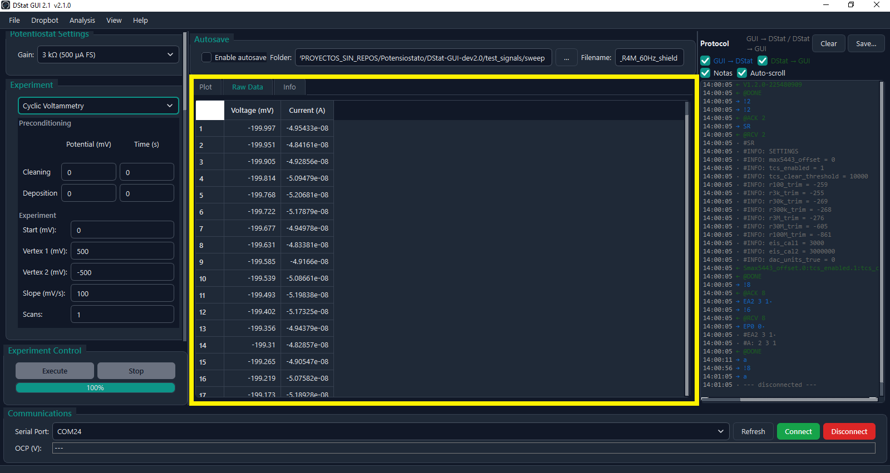
</p>

### Tab Info
Muestra información del experimento completado: técnica utilizada, parámetros empleados, duración, número de puntos adquiridos y estadísticas básicas si el análisis post-adquisición está habilitado.

<p align="center">
  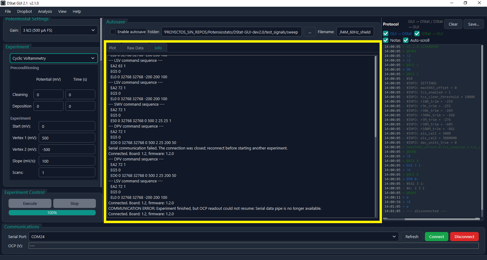
</p>

---

## 10. Guardado y Exportación

> Menú **File**.

<!-- CAPTURA PENDIENTE: Diálogo File -> Save Data... -->

| Acción | Formato | Descripción |
|--------|---------|-------------|
| **File → Save Current Data…** | `.txt` (TSV) o `.npy` | Exporta los datos numéricos. El `.txt` tiene cabeceras con el nombre del canal y número de scan. El `.npy` es un archivo NumPy multi-array. |
| **File → Save Plot…** | `.pdf` o `.png` | Exporta el gráfico activo con la resolución actual. |
| **File → Save Parameters…** | `.yml` | Guarda todos los parámetros del experimento actual en un archivo YAML para reproducirlo después. |
| **File → Load Parameters…** | `.yml` | Carga un perfil de parámetros guardado previamente y rellena todos los campos automáticamente. |

---

## 11. Autosave

> Barra **Autosave** en la parte superior de la columna central.

<!-- CAPTURA: Barra Autosave con el checkbox, campo de carpeta y de nombre de archivo -->
<p align="center">
  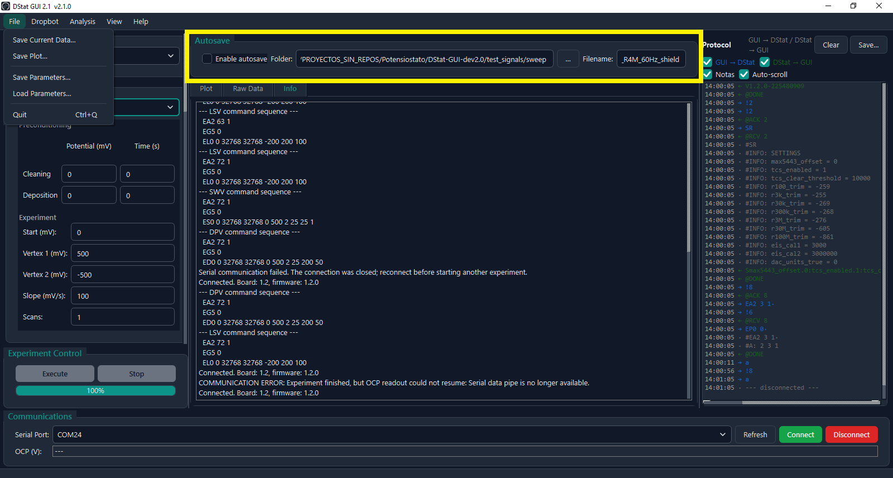
</p>

| Control | Descripción |
|---------|-------------|
| **Enable autosave** (checkbox) | Activa el guardado automático al finalizar cada experimento. |
| **Folder** | Directorio de destino. Usar el botón **…** para abrir el explorador de carpetas. |
| **Filename** | Prefijo base del nombre de archivo. El sistema agrega automáticamente un índice numérico incremental al completar cada scan para evitar sobreescrituras (ej. `experiment_001.txt`, `experiment_002.txt`, …). |

---

## 12. Calibración y Configuración del Dispositivo

> **View → Calibration / Device Settings…**

<!-- CAPTURA: Ventana de calibración con los grupos DAC, Current gain trims y sección de botones Read/Write -->
<p align="center">
  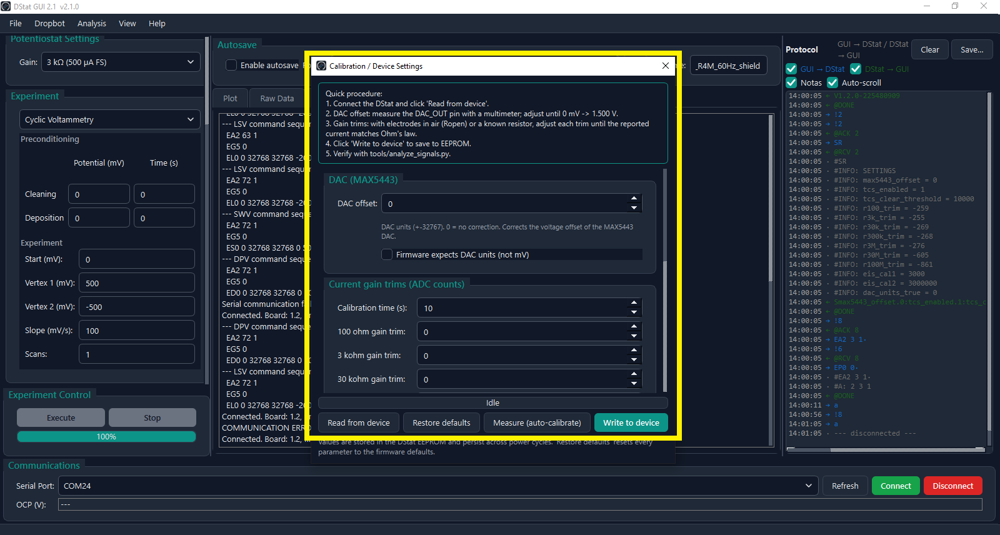
</p>

El diálogo **Calibration / Device Settings** permite ajustar los parámetros de calibración almacenados en la EEPROM del instrumento.

### Procedimiento de Calibración

1. **Conectar el instrumento** y abrir el diálogo.
2. Presionar **Read from device** para cargar los valores actuales desde la EEPROM.
3. **Offset del DAC (`max5443_offset`):**
   - Medir el pin `DAC_OUT` con un multímetro de precisión.
   - Ajustar el valor (rango ±32767 DAC counts) hasta que un comando de 0 mV produzca exactamente **1.500 V** en la salida del DAC.
4. **Trims de ganancia de corriente (`rXXX_trim`):**
   - Para cada rango de ganancia TIA (100 Ω, 3 kΩ, 30 kΩ, 300 kΩ, 3 MΩ, 30 MΩ, 100 MΩ):
     - Conectar una resistencia patrón de precisión conocida entre WE y CE/RE.
     - Ejecutar una cronoamperometría con un potencial fijo conocido.
     - Ajustar el trim hasta que la corriente medida coincida con $I = V / R$.
5. Presionar **Write to device** para grabar en EEPROM.
6. Verificar la calibración con el script `tools/analyze_signals.py` (ver [Caracterización](./characterization/README.md)).

### Parámetros disponibles

| Parámetro | Rango | Descripción |
|-----------|-------|-------------|
| `max5443_offset` | −32767 … 32767 | Corrección de offset del DAC MAX5443. |
| `r100_trim` … `r100M_trim` | (ADC counts) | Corrección de ganancia individual por rango TIA. |
| `dac_units_true` | checkbox | Si está activo, el firmware espera índices DAC en vez de mV. |

> **⚠️ Nota:** El diálogo de calibración solo está disponible mientras el instrumento está conectado. Los cambios solo son persistentes si se presiona **Write to device**.

---

## 13. Análisis Post-Adquisición

> **Analysis → Analysis Options…** + **Analysis → Run Analysis**

<!-- CAPTURA: Diálogo Analysis Options con el grupo Statistics -->
<p align="center">
  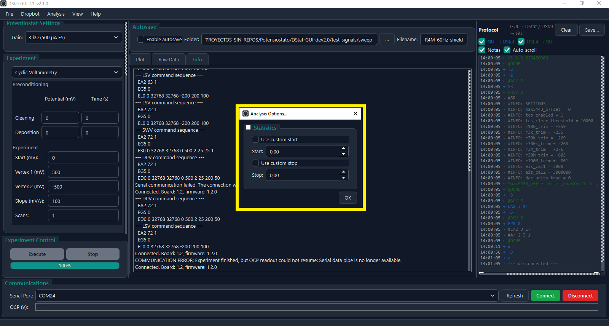
</p>

Tras finalizar un experimento, se puede ejecutar análisis estadístico básico sobre los datos adquiridos:

| Opción | Descripción |
|--------|-------------|
| **Statistics** (grupo checkable) | Activa el cálculo de estadísticas (media, desvío, área bajo la curva) sobre el canal de corriente. |
| **Use custom start / stop** | Permite recortar el rango de análisis a un subintervalo definido manualmente (en unidades del eje X: segundos o mV según la técnica). |

Presionar **Analysis → Run Analysis** ejecuta el análisis con los parámetros configurados y actualiza la tab **Info** con los resultados.

---

## 14. Terminal de Protocolo (Protocol Terminal)

> Columna derecha. Visible/oculta con **View → Protocol Terminal** (`Ctrl+P`).

<!-- CAPTURA: Panel Protocol Terminal mostrando el log de la conversación serie -->
<p align="center">
  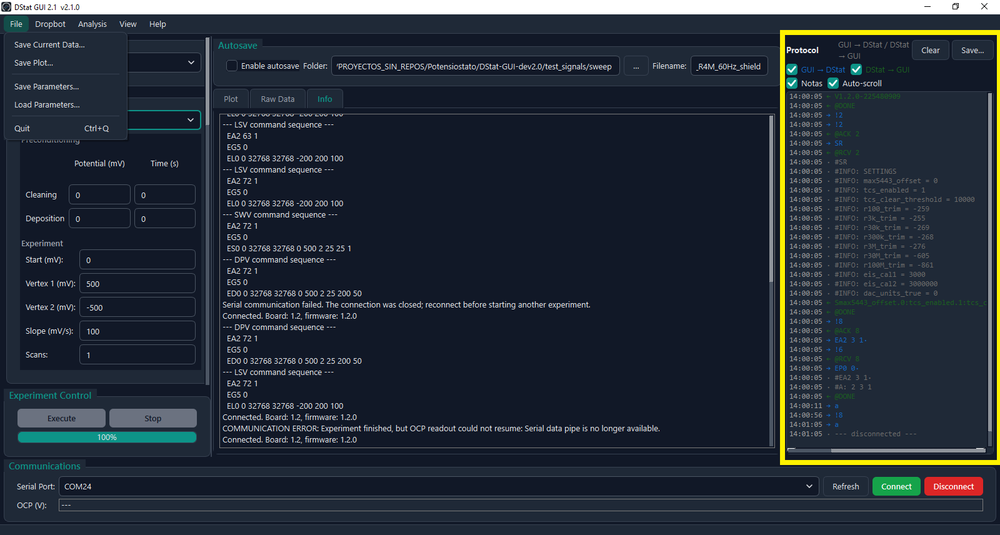
</p>

Muestra en tiempo real la conversación serie bidireccional entre la GUI y el microcontrolador del DStat. Útil para diagnóstico de comunicación y depuración.

- Líneas **info** (negras/blancas): mensajes de estado de la GUI.
- Líneas de **protocolo** (color): tramas enviadas y recibidas en crudo.
- Líneas **error** (rojas): errores de comunicación o timeout.

---

## 15. Referencia de Técnicas Electroquímicas

### 🔁 Cyclic Voltammetry (CV) — Voltamperometría Cíclica
**Resultado:** Gráfico Corriente vs. Tensión (ciclos triangulares)

Barre el potencial desde un valor de inicio hasta un vértice y regresa. Puede repetir múltiples ciclos. La técnica más empleada para caracterizar reacciones redox.

| Parámetro | Descripción | Rango | Valor típico |
|-----------|-------------|-------|-------------|
| **Start (mV)** | Potencial inicial del barrido | −1500 … 1499 | 0 |
| **Vertex 1 (mV)** | Potencial máximo del barrido | −1500 … 1499 | +500 |
| **Vertex 2 (mV)** | Potencial mínimo del barrido | −1500 … 1499 | −500 |
| **Slope (mV/s)** | Velocidad de barrido (scan rate) | 1 … 2000 | 100 |
| **Scans** | Número de ciclos completos | 1 … 255 | 1–5 |

**Aplicaciones:** Caracterización de electrocatalizadores, estudio de mecanismos redox, determinación de coeficientes de difusión (Randles-Ševčík), diagnóstico de electrodos.

---

### 📈 Linear Sweep Voltammetry (LSV) — Voltamperometría de Barrido Lineal
**Resultado:** Gráfico Corriente vs. Tensión (barrido único)

Barrido unidireccional de Start a Stop. Genera una curva de polarización.

| Parámetro | Descripción | Rango | Valor típico |
|-----------|-------------|-------|-------------|
| **Start (mV)** | Potencial inicial | −1500 … 1499 | −200 |
| **Stop (mV)** | Potencial final | −1500 … 1499 | +200 |
| **Slope (mV/s)** | Velocidad de barrido | 1 … 2000 | 100 |

**Aplicaciones:** Curvas de polarización, corriente límite de difusión, análisis de corrosión, screening rápido de materiales.

---

### 〰️ Square Wave Voltammetry (SWV) — Voltamperometría de Onda Cuadrada
**Resultado:** Corriente neta, directa e inversa vs. Tensión

Superpone una onda cuadrada al barrido lineal. Suprime prácticamente toda la corriente capacitiva → límites de detección muy bajos.

| Parámetro | Descripción | Rango | Valor típico |
|-----------|-------------|-------|-------------|
| **Start / Stop (mV)** | Rango de potencial | −1500 … 1499 | 0 / +500 |
| **Step (mV)** | Incremento de potencial por ciclo | 1 … 200 | 2 |
| **Pulse (mV)** | Amplitud de la onda cuadrada | 1 … 150 | 25 |
| **Frequency (Hz)** | Frecuencia de la onda cuadrada | 1 … 1000 | 25 |
| **Scans** | Número de repeticiones | 1 … 255 | 1 |

**Aplicaciones:** Detección de trazas de metales pesados (Pb, Cd, Hg), análisis de fármacos y biomarcadores, sensores electroquímicos de alta sensibilidad.

---

### 📊 Differential Pulse Voltammetry (DPV) — Voltamperometría de Pulso Diferencial
**Resultado:** Corriente diferencial vs. Tensión

Aplica pulsos rectangulares de amplitud fija y registra la diferencia de corriente al final de cada pulso. Cancela buena parte de la corriente capacitiva.

| Parámetro | Descripción | Rango | Valor típico |
|-----------|-------------|-------|-------------|
| **Start / Stop (mV)** | Rango de potencial | −1500 … 1499 | 0 / +500 |
| **Step (mV)** | Incremento de potencial | 1 … 200 | 2–5 |
| **Pulse (mV)** | Amplitud del pulso | 1 … 150 | 25–50 |
| **Period (ms)** | Periodo entre pulsos | 1 … 1000 | 200–500 |
| **Width (ms)** | Duración del pulso (**menor** que el periodo) | 1 … 1000 | 20–50 |

**Aplicaciones:** Análisis de trazas en agua/suelos/bebidas, determinación de metales pesados con elevada selectividad, medición de fármacos en fluidos biológicos.

---

### ⏱️ Chronoamperometry (CA) — Cronoamperometría
**Resultado:** Gráfico Corriente vs. Tiempo

Aplica uno o varios escalones de potencial y registra la evolución temporal de la corriente.

| Parámetro | Descripción | Rango | Valor típico |
|-----------|-------------|-------|-------------|
| **Potential (mV)** | Potencial aplicado en cada escalón | −1500 … 1499 | depende del sistema |
| **Time (s)** | Duración de cada escalón | 0 … 65535 | 10–60 |

Se pueden encadenar múltiples pares potencial/tiempo con los botones **+ Add** y **− Remove** en el panel de la técnica.

**Aplicaciones:** Cálculo de coeficientes de difusión (ecuación de Cottrell), biosensores amperométricos (glucosa, H₂O₂), electrodepositación, evaluación temporal de sensores.

---

### 🔋 Potentiometry — Potenciometría
**Resultado:** Gráfico Tensión vs. Tiempo

Mide el potencial de circuito abierto (OCP) sin aplicar corriente durante un tiempo determinado.

| Parámetro | Descripción | Rango | Valor típico |
|-----------|-------------|-------|-------------|
| **Time (s)** | Duración total de la medición | 0 … 65535 | 60 |

**Aplicaciones:** Medición de pH con electrodo de vidrio, electrodos selectivos de iones (ISE): Na⁺, K⁺, Cl⁻, monitoreo de estabilidad del potencial previo a un experimento, titulaciones potenciométricas.

---

## 16. Límites del Hardware y Validación

Los parámetros de cada experimento son validados automáticamente por la GUI antes de enviar el comando al instrumento. Si algún valor cae fuera del rango permitido, se muestra un mensaje de error y el experimento no se inicia.

| Parámetro | Rango admitido |
|-----------|----------------|
| Potenciales (Start, Stop, vértices, preacondicionamiento) | −1500 … 1499 mV |
| Slope / Scan rate (mV/s) | 1 … 2000 |
| Step (mV) | 1 … 200 |
| Pulse (mV) | 1 … 150 |
| Frequency (Hz) | 1 … 1000 |
| Period / Width (ms) | 1 … 1000 (Width debe ser menor que Period) |
| Scans | 1 … 255 |
| Tiempos (s) | 0 … 65535 |

---

## 17. Menús de la Aplicación y Atajos

<!-- CAPTURA: Barra superior de menús desplegada (File / View / Help) -->
<p align="center">
  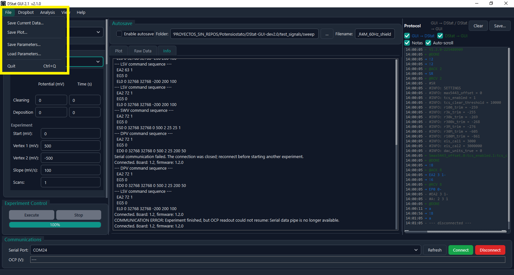
</p>

### Menú File (Archivo)
- **Save Current Data…:** Guarda los datos del último experimento en formato tabular (TSV/CSV/XML).
- **Save Plot…:** Exporta la gráfica actual a archivo de imagen (PNG, PDF, SVG, etc.).
- **Save Parameters…:** Guarda la configuración del panel de experimento en un archivo de parámetros reutilizable.
- **Load Parameters…:** Carga parámetros guardados previamente en una sesión anterior.
- **Quit (`Ctrl+Q`):** Cierra la aplicación desconectando el puerto serie de forma ordenada.

### Menú DropBot
- **Connect:** Inicia la escucha sobre el socket ZMQ para recibir comandos automatizados desde µDrop / DropBot. *(Deshabilitado si pyzmq no está instalado).*
- **Disconnect:** Desconecta el canal de automatización ZMQ.

### Menú Analysis
- **Analysis Options…:** Configura los métodos de detección de picos y sustracción de línea de base.
- **Run Analysis:** Ejecuta el algoritmo de análisis sobre la curva cargada en la vista principal.

### Menú View (Ver)
- **Protocol Terminal (`Ctrl+P`):** Alterna la visibilidad del panel derecho con el log serie en tiempo real.
- **Calibration / Device Settings…:** Abre el diálogo de configuración de EEPROM y calibración interna de ganancias y offsets.
- **Theme:** Permite alternar entre los estilos de interfaz:
  - `System (default)`: Utiliza el tema del sistema operativo.
  - `Light`: Tema claro de alto contraste.
  - `Dark`: Tema oscuro moderno para entornos de baja luminosidad.

### Menú Help (Ayuda)
- **Experiment Guide:** Despliega una ventana con la guía teórica y parámetros recomendados para cada técnica electroquímica.
- **About:** Muestra información de la versión de software, autores y enlaces al repositorio.

---

## 18. Flujo de Trabajo Típico (Paso a Paso)

<!-- CAPTURA PENDIENTE: Secuencia de trabajo con celda conectada y cables apantallados -->

Para realizar una medición voltamperométrica o amperométrica estándar, siga esta secuencia:

1. **Conexión de la Celda:**
   - Conecte el cable apantallado al conector frontal del DStat.
   - Conecte los electrodos en la celda:
     - **WE (Working Electrode):** Electrodo de trabajo.
     - **RE (Reference Electrode):** Electrodo de referencia (e.g. Ag/AgCl, SCE).
     - **CE (Counter Electrode):** Contraelectrodo (e.g. hilo de Pt, grafito).
   - *(Si trabaja a 2 electrodos, active la casilla `2 Electrode Mode` en ADC Settings).*

2. **Conexión por USB y Comunicación:**
   - Enchufe el DStat al puerto USB de la computadora.
   - En la sección inferior **Communications**, seleccione el puerto serie asignado y presione **Connect**.
   - Verifique que la barra de estado confirme la conexión y que el campo **OCP (V)** empiece a informar el potencial de circuito abierto en reposo.

3. **Selección del Rango de Corriente (Ganancia TIA):**
   - En **Potentiostat Settings**, ajuste la **Gain** según la corriente máxima esperada:
     - Reacciones redox en microelectrodos: `300 kΩ` a `3 MΩ` (rango de microamperios a nanoamperios).
     - Electrodos milimétricos estándar (1–3 mm): `3 kΩ` o `30 kΩ` (rango de microamperios a miliamperios).

4. **Configuración de Parámetros de la Técnica:**
   - En **Experiment**, seleccione la técnica deseada (e.g., *Cyclic Voltammetry*).
   - Ingrese los potenciales límite, la velocidad de barrido (*Scan rate*) y el número de ciclos.
   - *(Opcional)* Si su electrolito requiere desoxigenación o estabilización, configure un tiempo de reposo en **Preconditioning**.

5. **Configuración de Autosave (Recomendado):**
   - Active la casilla **Enable autosave** en la barra superior.
   - Seleccione la carpeta destino (`Folder`) para que cada adquisición se guarde automáticamente en formato TSV sin riesgo de pérdida de datos.

6. **Ejecución de la Medición:**
   - Presione el botón **Execute** (`btn_execute`).
   - El potencióstato aplicará la forma de onda programada y la gráfica se irá trazando en vivo punto a punto.
   - Si necesita interrumpir la medición en cualquier momento, presione **Stop**.

7. **Inspección y Guardado:**
   - Examine la pestaña **Plot** para verificar la forma de onda.
   - Revise la pestaña **Raw Data** para inspeccionar la tabla de valores numéricos brutos.
   - Si no utilizó autosave, guarde los datos manualmente con **File → Save Current Data…** o la figura con **File → Save Plot…**.

---

## 19. Integración con Microfluídica (DropBot)

> [!WARNING]
> **Estado: Funcionalidad No Testeada en DStat-RD**  
> La integración con DropBot (µDrop vía ZeroMQ) es una característica heredada del software original del Wheeler Microfluidics Lab. **Actualmente no ha sido testeada ni validada con el hardware de DStat-RD**. Se mantiene disponible en la interfaz para compatibilidad con sistemas DMF (Digital Microfluidics), pero su correcto funcionamiento no está garantizado sin validación previa en laboratorio.

<!-- CAPTURA PENDIENTE: Menú DropBot o esquema de conexión DropBot-DStat (No testeado) -->

DStat GUI incluye soporte para automatización de experimentos electroquímicos integrados con el sistema de microfluídica digital **DropBot** mediante comunicación ZMQ:

- La GUI actúa como nodo de escucha esperando comandos JSON a través del puerto configurado por ZMQ (`tcp://*:...`).
- En un sistema DropBot validado, permite desencadenar secuencias de movimiento y mezcla de gotas seguidas de adquisiciones electroquímicas coordinadas sin intervención manual del operador.
- **Para uso autónomo del DStat-RD:** Esta función debe permanecer desconectada (`Dropbot → Disconnect`). No es requerida para mediciones electroquímicas convencionales en celda o electrodos serigrafiados (SPE).

---

## 20. Diagnóstico Rápido de Señales Anómalas

<!-- CAPTURA PENDIENTE: Gráfica con señal saturada (línea plana horizontal superior o inferior / clipping) -->

| Síntoma en la Gráfica | Causa Probable | Acción Correctiva |
|-----------------------|----------------|-------------------|
| **Línea plana horizontal a corriente máxima o mínima** | **Saturación del TIA (Clipping):** la corriente real excede el fondo de escala de la resistencia seleccionada. | Bajar la ganancia del TIA en **Gain** (e.g., pasar de `300 kΩ` a `30 kΩ` o `3 kΩ`). |
| **Ruido periódico de alta amplitud (~50 Hz / 60 Hz)** | Interferencia electromagnética de la red eléctrica en los cables de la celda. | Usar caja de Faraday con conexión a GND del chasis. Ajustar **Sample Rate** del ADC a **50 Hz** o **60 Hz** según la red local. |
| **OCP fijo en −1.500 V o +1.499 V** | Circuito abierto en electrodo de referencia o contraelectrodo desconectado. | Verificar las pinzas cocodrilo/conectores y la continuidad del electrodo de referencia en el electrolito. |
| **Corriente prácticamente nula en todas las técnicas** | WE no está en contacto con la solución o celda en circuito abierto. | Verificar la conexión física del Working Electrode y el puente salino. |
| **Picos o saltos bruscos ("glitches") durante el barrido** | Burbujas de aire adheridas a la superficie del electrodo o agitación mecánica excesiva. | Desgasificar la celda, eliminar burbujas sobre la superficie del electrodo y detener la agitación durante barridos voltamperométricos de alta sensibilidad. |

---

## 21. Documentación y Enlaces Relacionados

- 📖 **[Montaje y Conexión de Celdas (connection.md)](./connection.md):** Diagrama de conexionado físico de 2 y 3 electrodos y apantallamiento.
- ⚙️ **[Procedimiento de Calibración (calibration.md)](./calibration.md):** Calibración de ganancias TIA y offsets con resistencias patrón.
- 🛠️ **[Solución de Fallas y Driver (troubleshooting.md)](./troubleshooting.md):** Procedimiento para reconocimiento del puerto COM y recuperación en modo DFU con Atmel FLIP.
- 📈 **[Caracterización y Validación Experimental (characterization)](./characterization/README.md):** Ensayos con cargas resistivas conocidas (dummy cell de 1 MΩ, 4 MΩ y circuito abierto), evaluación de blindaje y filtrado de red.
- 🏗️ **[Montaje Mecánico y Carcasa (assembly.md)](./assembly.md):** Manual de ensamble del gabinete 3D y mecanizado.
