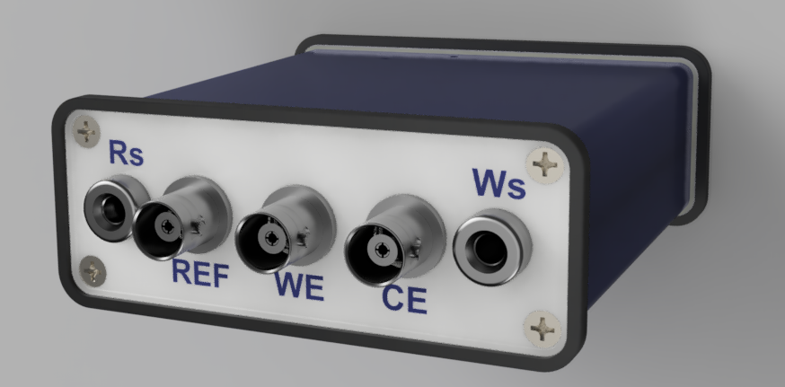
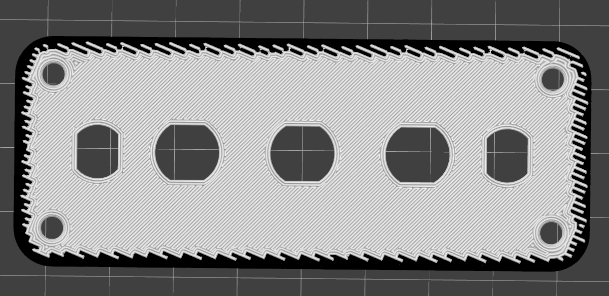

# DStat-RD / Diseño Mecánico

Este directorio almacena todos los recursos relacionados con el diseño mecánico, gabinete, soportes y piezas de montaje para el instrumento.

<p align="center">
  
</p>

---

## 📂 Organización de Carpetas

```text
mechanical/
├── step/        # Modelos en formato STEP (.step / .stp) neutral para interoperabilidad
├── stl/         # Mallas exportadas para impresión 3D (.stl / .3mf) e imágenes de técnica
├── renders/     # Renders fotorrealistas de la carcasa y ensambles
└── README.md    # Esta documentación
```

---

## 🖨️ Recomendaciones de Fabricación e Impresión 3D

- **Materiales sugeridos:** PETG, ABS o ASA para mayor resistencia térmica y química; PLA para prototipado rápido.
- **Altura de capa recomendada:** 0.20 mm.
- **Relleno (Infill):** 20% a 30% giroidal o cuadrícula.
- **Tolerancias mecánicas:** Considerar una tolerancia de 0.2 mm a 0.3 mm para las ranuras laterales de deslizamiento de la PCB y las ventanas de conectores BNC y USB.
- **Hardware de fijación:** Tornillos roscados directamente sobre los alojamientos de la pieza impresa en 3D (diseño optimizado sin necesidad de insertos metálicos). La PCB queda retenida por correderas sin tornillos.
- **Impresión Multimaterial con Interlocking (TPU + PLA):**  
  - Para los paneles frontal (`bnc.stl`) y posterior (`usb.stl`), es posible imprimir un borde exterior perimetral en **TPU** (material flexible) que funciona como paragolpes y protección contra caídas e impactos, manteniendo el cuerpo principal en **PLA** (material rígido).
  - Debido a que el TPU y el PLA poseen distinta composición polimérica y **no logran una adhesión química adecuada** entre sí durante la impresión, se emplea la técnica de **interlocking mecánico** (entrelazado geométrico / encastre por superposición de capas configurado en el *slicer*). Esto genera un anclaje físico positivo entre ambos materiales asegurando una unión sólida y permanente.

<p align="center">
  
</p>
